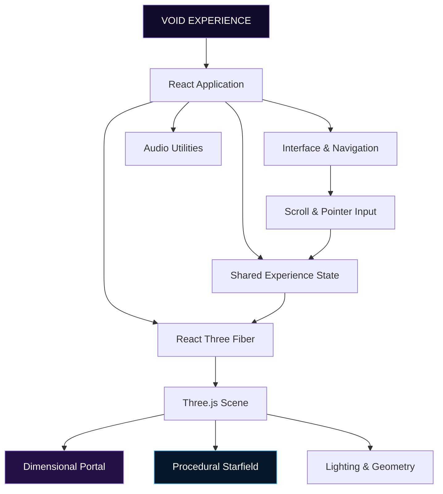

# ◈ VOID — INTO THE UNKNOWN

<p align="center">
  
</p>

<p align="center">
  
</p>

<p align="center">
  <strong>WHAT IF A WEBSITE WAS A PORTAL TO ANOTHER UNIVERSE?</strong>
</p>

<p align="center">
  A cinematic 3D web experience exploring fractured realities, cosmic dimensions, procedural graphics, and the space beyond existence.
</p>

<p align="center">
  <a href="#-enter-the-experience">ENTER THE EXPERIENCE</a> ·
  <a href="#-the-four-dimensions">THE FOUR DIMENSIONS</a> ·
  <a href="#-inside-the-engine">INSIDE THE ENGINE</a> ·
  <a href="#-launch-protocol">LAUNCH PROTOCOL</a>
</p>

<p align="center">
  
  
  
  
  
</p>

---

## ◉ TRANSMISSION 001 — THE AWAKENING

*Reality is only the beginning.*

Imagine entering a digital universe where space bends, light becomes architecture, and a dimensional gateway stands between the familiar and the impossible.

**VOID — Into the Unknown** transforms a conventional website into an experimental journey through an imagined multiverse. Built around real-time 3D rendering, procedural cosmic environments, custom GLSL shaders, and scroll-driven storytelling, it explores what happens when creative development becomes an immersive experience.

This is not simply a page with a 3D background.

**The dimension is the interface. The journey is the experience.**

<p align="center">
  
</p>

## ⟡ ENTER THE EXPERIENCE

<details>
<summary><strong>◈ DIMENSION 01 — THE THRESHOLD</strong></summary>

The beginning of the journey.

A luminous dimensional gateway introduces the visitor to the unknown. Procedural patterns, animated light, cosmic particles, and a deep atmospheric environment establish the scale of the experience.

**Core elements:** Shader-driven portal, luminous energy rings, cosmic starfield, and cinematic composition.

</details>

<details>
<summary><strong>◈ DIMENSION 02 — FRACTURED REALITY</strong></summary>

Where the rules of the familiar begin to dissolve.

This chapter explores distorted space, broken visual structures, and the idea of realities existing beyond our own.

**Core direction:** Abstract geometry, spatial distortion, and evolving visual transitions.

</details>

<details>
<summary><strong>◈ DIMENSION 03 — THE COSMIC ABYSS</strong></summary>

Enter a space where scale becomes incomprehensible.

The environment expands into a mysterious cosmic expanse, emphasizing isolation, depth, and the feeling of encountering something beyond ordinary understanding.

**Core direction:** Deep-space atmosphere, scattered stars, dark negative space, and luminous accents.

</details>

<details>
<summary><strong>◈ DIMENSION 04 — BEYOND EXISTENCE</strong></summary>

The final threshold.

Familiar visual structures give way to a more abstract environment where the boundaries between space, form, and reality become uncertain.

**Core direction:** Minimal spatial composition, restrained illumination, and mysterious transitions.

</details>

---

## ⌘ THE DIMENSIONAL ENGINE

<p align="center">
  
  
  
  
  
  
  
</p>

| Technology | Dimensional purpose |
|---|---|
| React | Component-based interface and application structure |
| TypeScript | Maintainable, type-safe application logic |
| Three.js | Real-time 3D graphics and scene rendering |
| React Three Fiber | Declarative 3D scenes within React |
| Drei | Supporting tools for React Three Fiber |
| GLSL | Custom procedural portal effects |
| Vite | Development server and build tooling |
| TanStack Router | Application routing |
| Tailwind CSS | Interface styling |
| Web Audio API | Optional ambient audio utilities |
| Vitest | Automated testing infrastructure |

## 🌀 THE PORTAL — CUSTOM SHADER ENGINEERING

The dimensional gateway is the central visual concept of VOID.

Rather than depending on a pre-rendered video, the portal uses custom shader calculations to create an animated, evolving visual field.

**Shader techniques represented in the project:**

- Procedural noise and layered noise calculations.
- Polar-coordinate transformations.
- Angular distortion and swirling patterns.
- Radial masks and luminous ring effects.
- Time-dependent animation values.
- Violet, blue, magenta, and white color transitions.
- Hover-reactive visual intensity.

These techniques demonstrate how mathematical operations executed by the GPU can become an expressive visual experience.

## 🌌 PROCEDURAL COSMIC ENVIRONMENT

The surrounding universe uses generated star positions and vertex colors to create a sense of depth and scale.

Instead of requiring a separate image for every star, the environment can represent the starfield through generated geometry and point rendering.

The result is a procedural backdrop that supports the portal without competing with it.

## 🎥 SCROLL-DRIVEN STORYTELLING

Scrolling is part of the navigation and narrative design.

The application tracks scroll progress and shares experience state with the 3D scene, providing a foundation for camera movement and transitions between chapters.

Other interactive details include:

- Custom animated cursor effects.
- Pointer-responsive magnetic buttons.
- Hover-sensitive visual feedback.
- An initialization screen with a progress indicator.
- Optional ambient audio controls.
- Responsive rendering behavior.
- Reduced-motion considerations.

---

## ⟁ SYSTEM ARCHITECTURE



The project separates the primary experience, scene rendering, audio utilities, shared state, routes, and reusable interface components into dedicated modules.

This architecture makes it easier to refine individual visual effects without restructuring the entire application.

## 📂 PROJECT STRUCTURE

```text
VOID/
├── public/
│   ├── favicon.ico
│   └── robots.txt
│
├── src/
│   ├── components/
│   │   ├── ui/
│   │   └── void/
│   │       ├── Experience.tsx
│   │       ├── Scene.tsx
│   │       ├── audio.ts
│   │       └── state.ts
│   │
│   ├── hooks/
│   ├── lib/
│   ├── routes/
│   ├── test/
│   ├── router.tsx
│   ├── routeTree.gen.ts
│   ├── server.ts
│   ├── start.ts
│   └── styles.css
│
├── package.json
├── bun.lock
├── vite.config.ts
├── tsconfig.json
├── eslint.config.js
└── README.md
```

*The structure reflects the supplied project documentation. Individual files may change as development progresses.*

---

## 🚀 LAUNCH PROTOCOL

### Requirements

- Node.js and npm, or Bun.
- Git.
- A modern browser with WebGL support.
- A code editor such as Visual Studio Code.

### 01 — Clone the repository

Replace the example URL with the actual repository URL if your repository uses a different name.

```bash
git clone https://github.com/adarshmuchatte-lang/dimensional-portal.git
```

### 02 — Enter the project directory

```bash
cd dimensional-portal
```

### 03 — Install dependencies

```bash
npm install
```

### 04 — Initialize the experience

```bash
npm run dev
```

### 05 — Enter the dimension

Open the local development URL printed in your terminal. Vite commonly uses:

```text
http://localhost:5173
```

### Production build

```bash
npm run build
npm run preview
```

The preview command serves the production build locally. Confirm that the build and preview work correctly before deployment.

---

## ⚡ PERFORMANCE & ACCESSIBILITY

A visually ambitious 3D experience must also account for the devices running it.

VOID includes a foundation for adaptive rendering and accessibility-conscious interaction.

- Responsive layout behavior.
- Consideration of reduced-motion preferences.
- Lower-intensity behavior for certain viewport and hardware conditions.
- GPU-based shader calculations.
- Procedural geometry for the starfield.
- Optional audio rather than mandatory sound.

**Next-level optimization opportunities:**

- Adaptive particle counts.
- Frame-rate and GPU profiling.
- Further mobile-specific interaction testing.
- Reduced-motion alternatives for more animations.
- Keyboard navigation and focus testing.
- Improved loading and asset management.

Performance varies with the device, browser, graphics hardware, and scene complexity.

---

## 🔮 BEYOND THE CURRENT DIMENSION

The next evolution of VOID could explore:

- [ ] More complex dimensional portals and orbital structures.
- [ ] Additional explorable 3D objects.
- [ ] More elaborate transitions between the four chapters.
- [ ] Interactive objects with contextual information.
- [ ] Additional atmospheric environments.
- [ ] Optional ambient soundscapes.
- [ ] Adaptive visual quality and particle scaling.
- [ ] Further mobile and accessibility testing.
- [ ] A cinematic project demonstration video.
- [ ] A public production deployment.

These are possible future improvements, not features claimed to be implemented already.

---

## ◈ THE CREATOR

**Adarsh Muchatte**

Information Technology Undergraduate · Creative Development · Interactive 3D Web Experiences

GitHub: [@adarshmuchatte-lang](https://github.com/adarshmuchatte-lang)

---

## ✦ FINAL TRANSMISSION

<p align="center">
  
</p>

<p align="center">
  <strong>REALITY IS THE FIRST LAYER.</strong><br/>
  <strong>THE UNKNOWN IS EVERYTHING BEYOND IT.</strong>
</p>

<p align="center">
  <code>VOID / INTO THE UNKNOWN / END OF TRANSMISSION</code>
</p>

<p align="center">
  <sub>An experimental 3D web experience built with React, Three.js, TypeScript, and custom shader techniques.</sub>
</p>
