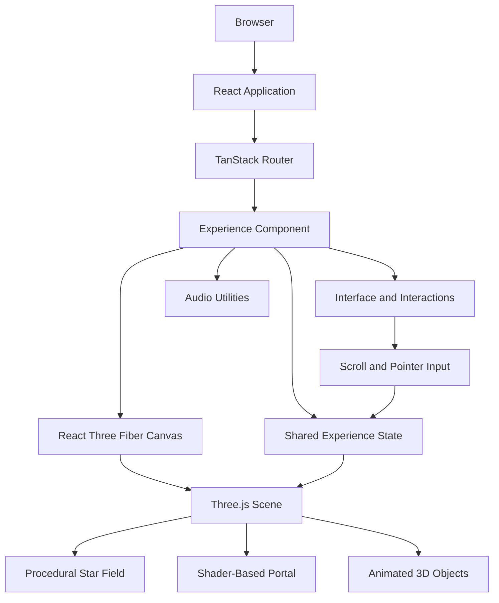

# 🌌 VOID — Into the Unknown

### An Immersive 3D Journey Through Dimensions, Fractured Realities, and the Cosmic Abyss

<p align="center">
  <strong>Where reality ends, the unknown begins.</strong>
</p>

<p align="center">
  A cinematic, interactive web experience built with React, Three.js, React Three Fiber, and TypeScript.
</p>

---

## 📖 Table of Contents

- [Overview](#-overview)
- [Vision and Concept](#-vision-and-concept)
- [Features](#-features)
- [Experience Chapters](#-experience-chapters)
- [Technology Stack](#-technology-stack)
- [System Architecture](#-system-architecture)
- [Project Structure](#-project-structure)
- [Getting Started](#-getting-started)
- [Installation and Setup](#-installation-and-setup)
- [Available Commands](#-available-commands)
- [How It Works](#-how-it-works)
- [Performance and Accessibility](#-performance-and-accessibility)
- [Development Guidelines](#-development-guidelines)
- [Troubleshooting](#-troubleshooting)
- [Future Enhancements](#-future-enhancements)
- [Contributing](#-contributing)
- [License](#-license)
- [Author](#-author)

---

## 🌠 Overview

**VOID — Into the Unknown** is an experimental 3D web experience designed to transform a conventional website into an interactive journey through a mysterious digital universe.

Instead of relying on static sections and conventional layouts, VOID combines real-time 3D rendering, procedural visual effects, animated cosmic environments, shader-based portal visuals, and cinematic scrolling to create an immersive atmosphere.

The experience guides visitors through four interconnected chapters, each representing a different stage of an imaginary journey beyond the boundaries of reality.

The project explores how modern web technologies can combine interactive graphics, animation, typography, sound, and storytelling into a cohesive digital experience.

### Project Highlights

- Real-time 3D rendering in the browser.
- Procedurally generated star fields.
- A custom shader-driven dimensional portal.
- Interactive camera movement and scroll-based transitions.
- A cinematic, dark visual aesthetic.
- Custom pointer interactions and magnetic buttons.
- Ambient audio controls.
- Responsive behavior and reduced-motion considerations.
- A modular React and TypeScript architecture.

**Project Type:** Interactive 3D Web Experience  
**Primary Focus:** Creative Development, Web Graphics, UI/UX, and Immersive Storytelling

---

## 🎯 Vision and Concept

The central idea behind VOID is simple:

> What if exploring a website felt like travelling through another dimension?

The interface is designed around the concept of a dimensional gateway. As the visitor moves through the experience, the environment evolves from an initial threshold into increasingly abstract and mysterious cosmic spaces.

The visual language uses deep backgrounds, luminous violet and blue tones, atmospheric lighting, and animated geometry to establish a sense of depth and scale.

The goal is not merely to display 3D graphics, but to integrate them into the navigation and storytelling of the experience.

### Design Principles

**1. Immersion over convention**

The 3D environment is the centrepiece of the experience rather than a decorative element placed behind a traditional website.

**2. Motion with purpose**

Scrolling, pointer movement, and transitions contribute to the feeling of travelling through an evolving environment.

**3. Minimal visual noise**

Typography, spacing, and selective visual effects help maintain focus on the central experience.

**4. Real-time interaction**

The scene is rendered dynamically, allowing visual elements to respond to time and user interaction.

**5. Modular development**

The experience, scene, audio utilities, and shared state are separated into distinct modules to support maintainability.

---

## ✨ Features

### 🌀 1. Interactive Dimensional Portal

The dimensional portal is the central visual element of VOID.

It uses a custom GLSL shader to generate a swirling, luminous visual effect with a bright inner boundary and an evolving energy field.

The shader combines procedural noise, angular distortion, radial calculations, and animated time-based values to create an abstract portal appearance.

Key elements include:

- Animated swirling patterns.
- Procedural noise-based visual variation.
- A luminous photon-ring effect.
- Violet, blue, magenta, and white color transitions.
- Hover-reactive visual intensity.
- A layered glow and halo effect.

### 🌌 2. Procedural Cosmic Environment

The surrounding environment uses procedurally generated star geometry to establish a sense of vastness and depth.

The star field uses generated positions and vertex colors to create a varied cosmic backdrop.

This approach reduces the need for individual image assets for the star field and allows the environment to be rendered directly by the graphics engine.

### 🎥 3. Scroll-Driven Cinematic Transitions

Scrolling is integrated into the experience's progression through the different chapters.

The application tracks scroll progress and shares that information with the 3D scene, allowing camera positioning and visual composition to evolve with the visitor's journey.

The intended effect is to make navigation feel like moving through an environment rather than jumping between unrelated content sections.

### 🖱️ 4. Interactive Pointer Effects

VOID incorporates custom pointer interactions for compatible desktop devices.

These include:

- An animated pointer dot.
- A smoothly following outer cursor ring.
- Enlarged cursor feedback over interactive elements.
- Magnetic button movement based on pointer position.
- Hover-sensitive visual feedback.

These details add responsiveness without requiring a conventional cursor trail library.

### 🎧 5. Ambient Audio Controls

The project includes an audio utility module for creating an ambient drone and controls for enabling or disabling sound.

The audio is intended to complement the visual experience with a subtle atmospheric layer.

Audio remains optional so visitors can explore the experience without sound.

### 🌑 6. Four Narrative Chapters

The experience is organized into four chapters:

1. The Threshold
2. Fractured Reality
3. The Cosmic Abyss
4. Beyond Existence

Each chapter contributes to the broader narrative of crossing a gateway into an unfamiliar universe.

### ⏳ 7. Immersive Loading Screen

A custom initialization screen introduces the experience before the main environment becomes available.

It features an animated progress indicator, a percentage display, and a minimal visual treatment consistent with the overall design.

### 📱 8. Responsive and Adaptive Behavior

The application includes logic that considers viewport width, available hardware concurrency, and the user's reduced-motion preference when selecting a lower-intensity rendering mode.

This provides a foundation for adapting the experience to different devices and accessibility preferences.

### 🎨 9. Custom Visual Design

The interface uses a deliberately restrained visual palette and custom styling to maintain a consistent atmosphere.

Design elements include:

- Dark backgrounds.
- Ultraviolet and cosmic blue accents.
- Monospaced labels.
- Cinematic typography and spacing.
- Fine borders and restrained highlights.
- Animated transitions and interactive controls.

### 🧩 10. Component-Based Architecture

The project uses React components and TypeScript to separate interface logic from 3D rendering.

The main experience, scene components, audio utilities, shared state, routing, and reusable UI components are maintained in separate files.

This makes it easier to improve individual features without rewriting the entire application.

---

## 🚀 Experience Chapters

### Chapter 01 — The Threshold

The journey begins at the gateway.

Light begins to bend, the environment establishes its scale, and the visitor is introduced to the dimensional portal.

**Visual direction:** Luminous portal geometry, cosmic particles, dark negative space, and subtle motion.

### Chapter 02 — Fractured Reality

The journey moves into a universe where familiar structures no longer follow familiar rules.

The chapter explores the idea of fragmented space, distorted reflections, and alternate realities.

**Visual direction:** Abstract geometry, shifting spatial relationships, and increasingly surreal imagery.

### Chapter 03 — The Cosmic Abyss

The environment expands into a vast and mysterious cosmic space.

The narrative emphasizes isolation, scale, and the feeling of encountering something beyond ordinary understanding.

**Visual direction:** Deep space, scattered cosmic matter, luminous accents, and atmospheric depth.

### Chapter 04 — Beyond Existence

The final chapter explores the boundary between structure and abstraction.

Space appears to fold inward, and familiar visual references gradually give way to a more minimal and mysterious environment.

**Visual direction:** Abstract spatial composition, restrained lighting, and an atmosphere of uncertainty.

---

## 🛠️ Technology Stack

| Technology | Purpose |
|---|---|
| React 19 | Component-based user interface |
| TypeScript | Type safety and maintainable application logic |
| Three.js | Real-time 3D graphics and rendering |
| React Three Fiber | Declarative Three.js rendering within React |
| @react-three/drei | Supporting utilities for React Three Fiber |
| Vite | Development server and build tooling |
| TanStack Start | Application framework and startup infrastructure |
| TanStack Router | Application routing |
| Tailwind CSS 4 | Utility-based styling |
| Radix UI | Accessible interface primitives |
| Lucide React | Icons |
| GLSL | Custom shader programming |
| Web Audio API | Browser-based ambient audio utilities |
| ESLint | Code quality and linting |
| Prettier | Code formatting |
| Vitest | Test runner |

The repository also includes supporting libraries for component interactions, form handling, validation, charts, date utilities, and other reusable interface functionality.

---

## 🏗️ System Architecture

The application follows a component-oriented architecture with a dedicated rendering layer for the immersive 3D experience.



### Architecture Components

**Experience Layer**

The main experience component coordinates loading behavior, chapter navigation, user interaction, audio controls, and the 3D canvas.

**Rendering Layer**

React Three Fiber provides the React integration for the Three.js scene. The scene contains the portal visuals, star field, lighting, and animated elements.

**Shader Layer**

Custom GLSL code calculates portal colors, procedural noise, swirling patterns, and luminous effects on the GPU.

**Interaction Layer**

Pointer movement, scrolling, button interaction, and audio controls provide the primary user inputs.

**Shared State Layer**

A shared state module communicates experience information, such as scroll progress, between the interface and the 3D scene.

**Routing Layer**

TanStack Router provides the application's route configuration and metadata.

---

## 📂 Project Structure

The primary application files are organized as follows:

```text
dimensional-portal/
├── public/
│   ├── favicon.ico
│   └── robots.txt
│
├── src/
│   ├── components/
│   │   ├── ui/
│   │   │   └── Reusable UI components
│   │   │
│   │   └── void/
│   │       ├── Experience.tsx
│   │       ├── Scene.tsx
│   │       ├── audio.ts
│   │       └── state.ts
│   │
│   ├── hooks/
│   │   └── use-mobile.tsx
│   │
│   ├── lib/
│   │   ├── error-capture.ts
│   │   ├── error-page.ts
│   │   ├── lovable-error-reporting.ts
│   │   └── utils.ts
│   │
│   ├── routes/
│   │   ├── __root.tsx
│   │   └── index.tsx
│   │
│   ├── test/
│   │   ├── app-routing.test.tsx
│   │   └── setup.ts
│   │
│   ├── router.tsx
│   ├── routeTree.gen.ts
│   ├── server.ts
│   ├── start.ts
│   └── styles.css
│
├── package.json
├── bun.lock
├── vite.config.ts
├── tsconfig.json
├── eslint.config.js
├── components.json
└── README.md
```

*Note: Generated files and some configuration files may vary as the project evolves.*

### Important Source Files

| File | Responsibility |
|---|---|
| `Experience.tsx` | Main interactive experience, loading UI, chapter navigation, cursor behavior, and audio controls |
| `Scene.tsx` | Three.js scene, procedural star field, shader-driven portal, and 3D visuals |
| `audio.ts` | Ambient audio utilities |
| `state.ts` | Shared state for the 3D experience |
| `index.tsx` | Main route and page metadata |
| `__root.tsx` | Root application layout |
| `styles.css` | Global styles and visual design |
| `router.tsx` | Router configuration |
| `vite.config.ts` | Development and build configuration |
| `package.json` | Dependencies and development scripts |

---

## 💻 Getting Started

### Prerequisites

Before running the project, ensure that you have:

- Node.js installed.
- npm installed, or Bun if you prefer using the included Bun lockfile.
- Git installed.
- A modern browser with WebGL support.
- A code editor such as Visual Studio Code.

Recommended: use a current Node.js LTS release compatible with the installed Vite version.

Check your installation:

```bash
node --version
npm --version
git --version
```

---

## ⚙️ Installation and Setup

### Option 1 — Run Locally with npm

**Step 1: Clone the repository**

Replace the repository URL below with your actual GitHub repository URL.

```bash
git clone https://github.com/adarshmuchatte-lang/dimensional-portal.git
```

**Step 2: Enter the project directory**

```bash
cd dimensional-portal
```

If you cloned a repository containing the project files directly, you can run the commands from that directory.

**Step 3: Install dependencies**

```bash
npm install
```

**Step 4: Start the development server**

```bash
npm run dev
```

**Step 5: Open the local website**

Vite will display the local development URL in your terminal. Open that address in your browser, commonly:

```text
http://localhost:5173
```

The exact port may vary if the default port is already occupied.

### Option 2 — Run with Bun

The repository contains a `bun.lock` file, so Bun can also be used.

```bash
bun install
bun run dev
```

Use one package manager consistently to avoid unnecessary lockfile differences.

### Create a Production Build

To create an optimized production build:

```bash
npm run build
```

To preview the generated build locally:

```bash
npm run preview
```

The production build and preview commands should be tested in your environment before deployment.

---

## 📜 Available Commands

| Command | Description |
|---|---|
| `npm run dev` | Start the development server |
| `npm run build` | Generate a production build |
| `npm run build:dev` | Generate a development-mode build |
| `npm run preview` | Preview the production build |
| `npm run lint` | Run ESLint |
| `npm run format` | Format files with Prettier |
| `npm test` | Run the Vitest test suite |
| `npm run test:watch` | Run tests in watch mode |

---

## 🧠 How It Works

### 1. Real-Time 3D Rendering

The scene is rendered through a Three.js canvas integrated into the React component tree using React Three Fiber.

This allows the 3D environment to be described through reusable components while still taking advantage of Three.js geometry, materials, shaders, and rendering capabilities.

### 2. Procedural Star Generation

The star field generates particle positions and colors through deterministic pseudo-random calculations.

The generated data is stored in buffer geometry and rendered as points, providing an efficient way to represent a large cosmic background.

### 3. Shader-Based Portal

The portal uses a custom vertex shader and fragment shader.

The fragment shader combines several techniques:

- UV coordinate transformations.
- Polar coordinate calculations.
- Angular distortion.
- Procedural noise.
- Fractal-style noise accumulation.
- Radial masks.
- Animated time uniforms.
- Color interpolation.
- A luminous ring effect.

The shader produces the portal's evolving appearance without requiring a pre-rendered portal video.

### 4. Scroll-Based Scene Progression

The experience tracks document scroll progress and exposes it through shared state.

The scene can use this progress to update the camera's position and create transitions between different visual stages.

This connects the narrative flow of the page to the underlying 3D environment.

### 5. Pointer Interaction

Pointer coordinates are used to calculate cursor positions and magnetic button offsets.

The visual feedback is updated during interaction, allowing interface elements to respond naturally to movement.

### 6. Ambient Audio

The audio module provides utilities for generating an ambient sound layer through browser audio capabilities.

The interface includes a sound control so visitors can choose whether to enable the experience's audio.

---

## ⚡ Performance and Accessibility

Real-time 3D graphics require careful consideration of rendering cost, browser capabilities, and user preferences.

The project includes a foundation for adaptive behavior, with additional optimization opportunities as the experience develops.

### Current Considerations

- A lower-intensity mode can be selected for narrow viewports.
- Hardware concurrency is considered when selecting rendering behavior.
- The user's reduced-motion preference is considered.
- The star field uses buffer geometry and point rendering.
- Shader calculations are executed by the GPU.
- Audio is optional.

### Recommended Improvements

- Test on integrated GPUs and lower-powered mobile devices.
- Monitor frame rate and memory usage.
- Avoid unnecessary object creation during animation frames.
- Reduce particle counts when rendering performance declines.
- Respect reduced-motion preferences across all animations.
- Ensure text contrast and keyboard navigation remain accessible.
- Test the audio control and all interactive buttons.
- Profile the production build rather than relying only on development performance.

**Performance note:** Actual frame rates depend on the device, browser, graphics hardware, viewport size, and scene complexity.

---

## 🧪 Testing and Quality Assurance

Before publishing a release, verify the following:

- [ ] The application starts without runtime errors.
- [ ] The portal renders correctly.
- [ ] The star field is visible.
- [ ] All four narrative chapters are present.
- [ ] Scroll navigation behaves as expected.
- [ ] Interactive buttons respond correctly.
- [ ] Magnetic pointer effects work on compatible devices.
- [ ] Audio can be enabled and disabled.
- [ ] The layout works on desktop and mobile screens.
- [ ] Reduced-motion behavior is checked.
- [ ] The production build completes successfully.
- [ ] No private credentials or environment secrets are committed.

Run the available checks:

```bash
npm run lint
npm test
npm run build
```

Resolve any failures before treating the release as production-ready.

---

## 🔮 Future Enhancements

VOID provides a foundation for further experimentation with immersive web technologies.

Potential future improvements include:

### Advanced Graphics

- More complex portal geometry and orbital structures.
- Volumetric-looking light and atmospheric fog.
- Additional shader effects and procedural materials.
- More elaborate cosmic environments.
- Enhanced transitions between chapter-specific scenes.

### Interaction

- More interactive objects within the 3D environment.
- Additional camera controls.
- Clickable objects that reveal contextual information.
- More responsive portal behavior.
- Optional keyboard navigation through the chapters.

### Audio

- Additional ambient soundscapes.
- More nuanced sound transitions.
- Better synchronization between audio and scene events.
- A persistent sound preference.

### Performance

- Adaptive quality settings.
- More detailed GPU performance profiling.
- Dynamic particle scaling.
- Further mobile-specific optimization.
- Improved loading and asset management.

### Deployment and Portfolio

- Production deployment with a public demo URL.
- Automated build and deployment through GitHub Actions.
- Screenshots and a project demonstration video.
- Performance testing across multiple browsers.
- A documented release process.

These are proposed enhancements, not claims that every feature is already implemented.

---

## 🤝 Contributing

Contributions, suggestions, and experiments are welcome.

To work on a change:

1. Fork the repository.
2. Create a feature branch.
3. Make your changes.
4. Run the relevant quality checks.
5. Submit a pull request with a clear description.

Example:

```bash
git checkout -b feature/new-cosmic-effect
```

Keep changes focused and avoid introducing unnecessary dependencies.

---

## 📄 License

No license has currently been selected for this repository.

Until a license is added, the project should not be assumed to be available for unrestricted redistribution or reuse. Add an appropriate license file if you intend to grant others explicit usage rights.

Review the licenses of third-party dependencies and assets separately.

---

## 👨‍💻 Author

**Adarsh Muchatte**

Information Technology Undergraduate | Web Development | Interactive 3D Experiences

GitHub: [@adarshmuchatte-lang](https://github.com/adarshmuchatte-lang)

---

## 🌌 Final Note

VOID is an exploration of what becomes possible when web development meets real-time graphics and interactive storytelling.

By combining React, TypeScript, Three.js, shader programming, and carefully designed motion, the project aims to create an experience that feels less like browsing a page and more like entering another world.

**Enter the threshold. Explore the unknown. Go beyond existence.**

<p align="center">
  <strong>VOID — Into the Unknown</strong>
</p>
